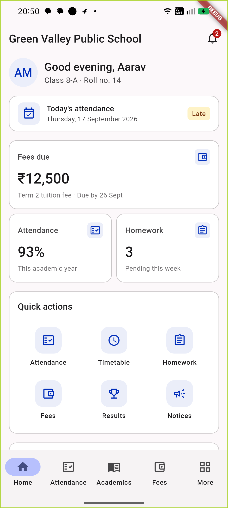
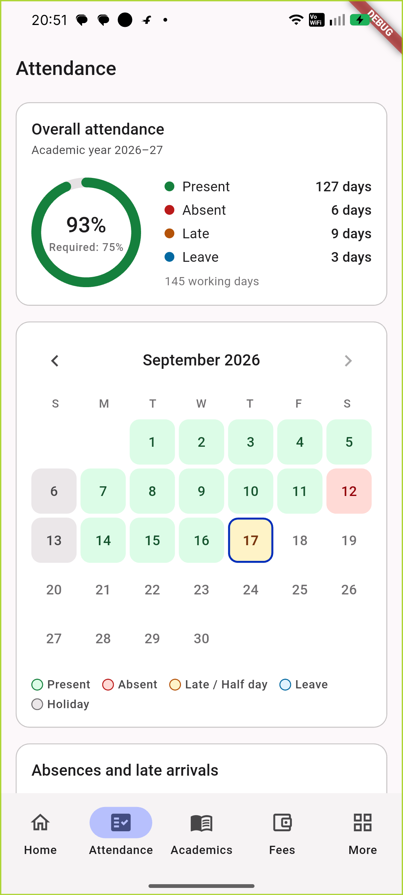
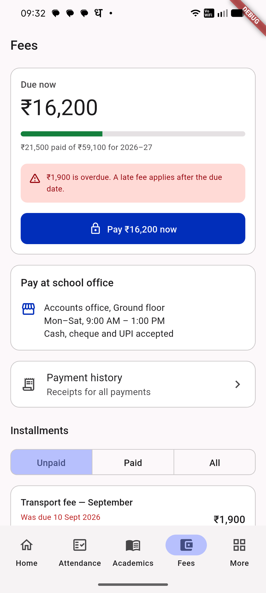

# School ERP (working name)

Mobile app for a multi-tenant Education ERP serving schools, colleges, coaching
institutes and tuition academies — multiple institutions, branches, roles and
dynamically enabled modules.

> **Status:** work in progress. The foundation (design system, navigation,
> localization, CI) and the student app modules below are built and tested on
> device. Progress is tracked in [docs/roadmap.md](docs/roadmap.md).

## Features

- **Auth:** login, secure token storage (`flutter_secure_storage`), session guard and auto sign-out on expiry
- **Dashboard & profile:** attendance, fees due and homework at a glance
- **Attendance:** monthly calendar, summary and day details
- **Academics:** timetable, homework with submission, results and report cards
- **Fees:** dues, term-wise and monthly installments, online payment and receipts
- **Notices:** notice board with attachments
- **Platform:** light/dark themes, English + Hindi, phone and tablet layouts

Built with Flutter, Riverpod, GoRouter and Dio, with an architecture decision
record for every major choice. Staging URLs in this repository are
placeholders; point the app at your own backend with
`--dart-define=API_BASE_URL=...`.

## Screenshots

<p>
  
  
  
</p>

Screens show demo data only.

| | |
|---|---|
| Platforms | Android (primary), iOS (prepared, needs a Mac to build) |
| Form factors | Phone + tablet |
| Min OS | Android 7.0 (API 24), iOS 15 |
| Package / bundle ID | `com.schoolerp.app` |
| Flutter / Dart | 3.47.2 stable / 3.13.2 |

## Quick start

```bash
flutter pub get
flutter run --flavor erpStaging
```

A flavor is **required** — the app refuses to start without one. See
[flavors](docs/architecture/flavors.md).

| Flavor | App name | Application ID |
|---|---|---|
| `erpStaging` | School ERP Staging | `com.schoolerp.app.staging` |
| `erpProd` | School ERP | `com.schoolerp.app` |

## Quality gate (run before every push — CI runs the same)

```bash
dart format --output=none --set-exit-if-changed .
flutter analyze --fatal-infos
flutter test
```

## Documentation

- [Documentation index](docs/README.md)
- [Development setup & commands](docs/development/setup.md)
- [Git workflow](docs/development/git-workflow.md)
- [Architecture overview](docs/architecture/overview.md)
- [Architecture decision records](docs/architecture/decisions/README.md)
- [Rules for AI agents and contributors](AGENTS.md)
